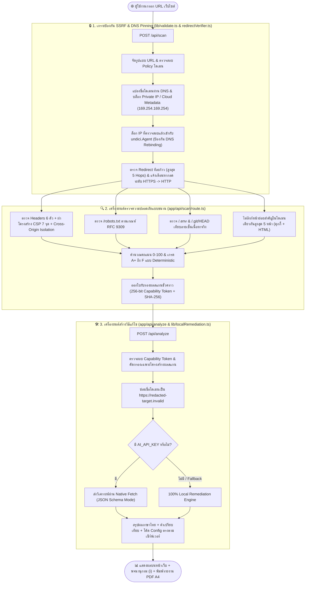

<div align="center">

# 🛡️ DevSec Guard

### **Automated Passive Web Security Auditor & EduSec Platform**
*สแกนเกราะความปลอดภัยเว็บไซต์จากภายนอกแบบไม่รุกราน แปลผลเป็นภาษามนุษย์เข้าใจง่าย พร้อมโค้ดวิธีแก้ไขที่นำไปวางใช้งานได้ทันที*

<p align="center">
  
  
  
  
  
</p>

<p align="center">
  <a href="#-ทำไมต้อง-devsec-guard">ทำไมต้อง DevSec Guard</a> •
  <a href="#-ฟีเจอร์หลัก-10-มิติ">ฟีเจอร์หลัก</a> •
  <a href="#-สถาปัตยกรรมและการไหลของข้อมูล">สถาปัตยกรรม</a> •
  <a href="#-เกณฑ์การให้คะแนน-deterministic-scoring">เกณฑ์การให้คะแนน</a> •
  <a href="#-โครงสร้างโปรเจกต์">โครงสร้างไฟล์</a> •
  <a href="#-การติดตั้งและเริ่มต้นใช้งาน">วิธีติดตั้ง</a> •
  <a href="#-api-reference">API</a>
</p>

</div>

---

> [!IMPORTANT]
> **Passive & Non-Intrusive Auditor:** ระบบทำงานโดยการอ่าน HTTP Response สาธารณะเหมือนเบราว์เซอร์เปิดหน้าเว็บปกติ **ไม่มีการยิง Payload โจมตี ไม่ส่งฟอร์ม และไม่แก้ไขข้อมูลใดๆ** บนเซิร์ฟเวอร์ปลายทาง กรุณาใช้งานกับเว็บไซต์ที่คุณเป็นเจ้าของหรือได้รับอนุญาตให้ตรวจสอบ

---

## 💡 ทำไมต้อง DevSec Guard?

เครื่องมือสแกนความปลอดภัยส่วนใหญ่สร้างมาเพื่อผู้เชี่ยวชาญ แสดงแต่ศัพท์เทคนิค (`CSP`, `HSTS`, `X-Frame-Options`, `COOP/COEP`) จนเจ้าของเว็บไซต์ทั่วไปไม่เข้าใจว่าเสี่ยงอย่างไร ในขณะที่นักพัฒนาเองก็ต้องเสียเวลาไปค้นหาโค้ดตั้งค่าของแต่ละ Web Server เอง

**DevSec Guard** จึงถูกออกแบบมาเพื่อเชื่อมช่องว่างระหว่าง **คนทั่วไป (Non-Tech)** และ **นักพัฒนา (Developers / DevSecOps)** ในหน้าเดียว:

| 👥 สำหรับคนทั่วไป & เจ้าของเว็บไซต์ | 💻 สำหรับนักพัฒนา & สาย DevSecOps |
| :--- | :--- |
| 🏠 **เปรียบเทียบเรื่องบ้านและอาคาร:** อธิบายช่องโหว่ด้วยภาพเปรียบเทียบ เช่น *"ประตูรั้วบ้าน", "กล้องวงจรปิด", "นามบัตรเผลอวางทิ้งไว้หน้าบ้าน"* | ⚙️ **โค้ดพร้อมวางตาม Stack จริง:** สร้าง Config ให้ตรงตามเซิร์ฟเวอร์ที่ตรวจพบ (`Next.js`, `Vercel`, `Nginx`, `Apache .htaccess`, `Cloudflare`) |
| ℹ️ **ปุ่มพจนานุกรม `(i)` ทุกจุด:** กดอ่านความหมาย ผลกระทบ และระดับความง่ายในการแก้ไขได้ทันทีโดยไม่ต้องออกจากหน้าเว็บ | 🎯 **คะแนนแม่นยำ 100% (Deterministic):** คำนวณคะแนน `0–100` และตัดเกรด `A+` ถึง `F` ด้วยกฎวิศวกรรมจาก HTTP Response จริง ไม่ใช้ AI มั่วเกรด |
| 📄 **พิมพ์รายงาน PDF ขนาด A4:** กดสั่งพิมพ์รายงานสรุปผลขาว-ดำแบบทางการสำหรับแนบส่งทีมไอทีหรือผู้บริหารได้ทันที | 🔒 **ซ่อนชื่อโดเมนอัตโนมัติ (Privacy-First):** แปลงชื่อเว็บเป็น `redacted-target.invalid` ก่อนส่งวิเคราะห์ พร้อมระบบ **100% Local Engine** ในตัว |

---

## ✨ ฟีเจอร์หลัก 10 มิติ

### 1. 🛡️ ตรวจ HTTP Security Headers & วิเคราะห์โครงสร้าง CSP เชิงลึก
* ตรวจสอบ Security Headers หลัก 6 รายการ: `Content-Security-Policy (CSP)`, `Strict-Transport-Security (HSTS)`, `X-Frame-Options`, `X-Content-Type-Options`, `Referrer-Policy`, และ `Permissions-Policy`
* **7-Point CSP Deep Breakdown:** ผ่าโครงสร้างนโยบาย CSP ออกเป็น 7 จุดย่อย (`default-src`, `script-src`, `style-src`, `object-src`, `base-uri`, `frame-ancestors`, `upgrade-insecure-requests`) พร้อมแจ้งเตือนเมื่อพบ `'unsafe-inline'` หรือ `'unsafe-eval'`
* **Cross-Origin Isolation Check:** ตรวจสอบ `COOP`, `COEP`, และ `CORP` เพื่อดูความพร้อมในการป้องกันการเข้าถึงหน่วยความจำข้ามโดเมน

### 2. 🤖 ตรวจการควบคุมบอท AI (`robots.txt` RFC 9309)
* ตรวจสอบไฟล์ `/robots.txt` ตามมาตรฐาน **RFC 9309** ว่ามีการกำหนดสิทธิ์ควบคุมบอทเก็บข้อมูลไปเทรน AI (`GPTBot`, `ClaudeBot`, `CCBot`, `Google-Extended`) หรือไม่
* รองรับการประมวลผลกฎตามลำดับความจำเพาะของชื่อบอท, กฎที่ยาวที่สุดชนะ (Longest-match wins), และการใช้ Wildcard (`*`, `$`)

### 3. 🔑 ตรวจไฟล์ความลับรั่วไหลด้วย Signature Verification (`/.env` & `/.git/HEAD`)
* ทดสอบการเข้าถึงไฟล์ `/.env` และ `/.git/HEAD` โดยไม่ตามลิงก์เปลี่ยนหน้า (`redirect: "manual"`)
* **แก้ปัญหา False Positive (Soft-200):** เว็บไซต์สมัยใหม่มักตอบสถานะ `200 OK` กับทุก URL เพื่อแสดงหน้า 404 สวยๆ ระบบจึงตรวจ **ลายเซ็นเนื้อหาจริง (Content Signature)** เช่น รูปแบบ `KEY=VALUE` หรือ `ref: refs/heads/` เพื่อแยกแยะระหว่าง **"ไฟล์หลุดจริง (`exposed`)"** กับ **"หน้าเว็บปกติ (`soft-200`)"**

### 4. 🕷️ ไต่ลิงก์ตรวจหน้าย่อยสำคัญอัตโนมัติ (Bounded Same-Origin Crawler)
* สกัดลิงก์ภายในโดเมนเดียวกันจากหน้าแรก และจัดลำดับความสำคัญเพื่อไต่ตรวจหน้าย่อยสูงสุด **5 หน้าสำคัญ** (เช่น `/login`, `/signin`, `/admin`, `/account`, `/contact`, `/privacy`) แบบขนาน
* ควบคุมเวลาต่อหน้าย่อยไม่เกิน `3 วินาที` เพื่อค้นหาคุกกี้หรือแบบฟอร์มที่ไม่ได้ปรากฏอยู่ในหน้าแรก

### 5. 🍪 ตรวจความปลอดภัยคุกกี้ & โครงสร้าง HTML
* **Cookie Audit:** ตรวจคุกกี้ทุกตัวใน `Set-Cookie` ว่าเปิดใช้ `HttpOnly`, `Secure`, `SameSite` และใช้คำนำหน้า `__Host-` หรือ `__Secure-` อย่างถูกต้องหรือไม่
* **HTML Surface Inspection:** ตรวจลิงก์ `target="_blank"` ที่ขาด `rel="noopener"`, ฟอร์มที่ส่งข้อมูลผ่าน `http://`, Mixed Content, จำนวน Inline Scripts และลิงก์โซเชียลมีเดียในหน้าเว็บ

### 6. 🧠 Anonymized AI + 100% Local Remediation Engine
* **ปกป้องความลับของเป้าหมาย:** ล้างชื่อโดเมนและข้อมูลระบุตัวตนออกทั้งหมด เปลี่ยนเป็น `https://redacted-target.invalid` ก่อนส่งวิเคราะห์
* **ทำงานได้ 100% แม้ไม่มี API Key:** หากไม่ได้ตั้งค่า `AI_API_KEY` หรือ AI ภายนอกขัดข้อง ระบบจะสลับมาใช้ **100% Local Remediation Engine** (`lib/localRemediation.ts`) สร้างคำอธิบายภาษาไทย คำเปรียบเทียบ และโค้ดแก้ไขตามชนิดของเซิร์ฟเวอร์ให้อัตโนมัติทันที

### 7. 🚨 คลังข่าวช่องโหว่จริงจาก CISA KEV (Live Threat Intelligence)
* ดึงข้อมูลช่องโหว่ที่กำลังถูกแฮกเกอร์ใช้โจมตีจริงจากฐานข้อมูล **CISA Known Exploited Vulnerabilities (KEV)**
* แสดงผลทั้งในรูปแบบ **สไลด์การ์ดอัตโนมัติ** ในหน้าหลัก (`#night`) และหน้าตารางค้นหาฉบับเต็มที่ `/vulnerabilities` พร้อมแปลสรุปและวิธีรับมือเป็นภาษาไทย/อังกฤษ

### 8. 🖨️ ระบบพิมพ์รายงาน PDF ขนาด A4 & ส่งออกหลายรูปแบบ
* **A4 Print Engine (`createPortal`):** แยกเลเยอร์เอกสารพิมพ์ออกมาที่ `document.body` พร้อมกฎ `@media print` เพื่อให้สั่งพิมพ์หรือบันทึกเป็น **PDF ขนาด A4 ขาว-ดำ** ได้อย่างสะอาดสวยงาม ไม่ติดภาพพื้นหลัง
* รองรับการดาวน์โหลดรายงานฉบับออฟไลน์ (`.html`), ข้อมูลดิบ (`.json`) และส่งสรุปผลทางอีเมล

---

## 🏗️ สถาปัตยกรรมและการไหลของข้อมูล



---

## 📊 เกณฑ์การให้คะแนน (Deterministic Scoring)

ระบบคำนวณคะแนนเริ่มต้นจาก **100 คะแนนเต็ม** แล้วหักตามความเสี่ยงที่ตรวจพบจริงจาก HTTP Response ณ เวลานั้น:

| รายการที่ตรวจพบ | คะแนนที่หัก | เหตุผลทางวิศวกรรมความปลอดภัย |
| :--- | :---: | :--- |
| 🚨 **ไฟล์ `/.env` หรือ `/.git/HEAD` หลุดสู่สาธารณะ (`exposed`)** | **-45** (เพดานสูงสุดไม่เกิน 35 คะแนน) | ความเสี่ยงวิกฤต รหัสผ่านฐานข้อมูลหรือซอร์สโค้ดอาจรั่วไหลได้ทันที |
| 🛡️ **ขาด `Content-Security-Policy (CSP)`** | **-20** | เว็บไซต์ขาดเกราะหลักในการป้องกันการฝังสคริปต์แปลกปลอม (XSS) |
| ⚠️ **มี CSP แต่เปิด `'unsafe-inline'` หรือ `'unsafe-eval'` ในสคริปต์** | **-8** | ลดทอนประสิทธิภาพของ CSP ในการป้องกัน XSS |
| 🔐 **ขาด `Strict-Transport-Security (HSTS)`** | **-15** | เสี่ยงต่อการถูกบังคับลดระดับการเชื่อมต่อเป็น HTTP (SSL Stripping) |
| 🖼️ **ขาดทั้ง `X-Frame-Options` และ `frame-ancestors`** | **-15** | เสี่ยงต่อการถูกนำเว็บไปซ้อนในกรอบใสเพื่อหลอกให้คลิก (Clickjacking) |
| 📄 **ขาด `X-Content-Type-Options: nosniff`** | **-10** | เบราว์เซอร์อาจเดาชนิดไฟล์เองจนรันไฟล์อันตราย (MIME Sniffing) |
| 🔗 **ขาด `Referrer-Policy`** | **-8** | URL ที่มีข้อมูลสำคัญอาจหลุดไปกับ Header `Referer` เมื่อคลิกลิงก์ออกนอกเว็บ |
| 🎙️ **ขาด `Permissions-Policy`** | **-7** | ไม่ได้จำกัดสิทธิ์การเข้าถึงกล้อง ไมโครโฟน หรือพิกัดของผู้ใช้ล่วงหน้า |
| 🍪 **คุกกี้ไม่ปลอดภัย (ขาด `HttpOnly`, `Secure` หรือ `SameSite`)** | สูงสุด **-15** | เสี่ยงต่อการถูกขโมยคุกกี้ผ่านสคริปต์หรือการโจมตีข้ามเว็บ (CSRF) |
| 🌐 **จุดสังเกตใน HTML / การลดระดับ HTTPS -> HTTP / ไม่พบ `robots.txt`** | สูงสุด **-22** | ลดความเสี่ยงรอบด้านของโครงสร้างหน้าเว็บและการควบคุมบอท |

> **เกณฑ์การตัดเกรด:** `A+` (95–100) • `A` (85–94) • `B` (70–84) • `C` (55–69) • `D` (40–54) • `F` (0–39)

---

## 🔒 มาตรการป้องกันตนเองของระบบ (Self-Defense Architecture)

1. **Multi-Layer SSRF Protection (`lib/validate.ts`):**
   - บล็อก Private IPv4 (`10.0.0.0/8`, `172.16.0.0/12`, `192.168.0.0/16`), Loopback (`127.0.0.0/8`, `::1`), Link-Local & Cloud Metadata (`169.254.169.254`), CGNAT (`100.64.0.0/10`) รวมถึง IPv6 Transition/Mapped addresses (`::ffff:7f00:1`, `64:ff9b::/96`, `2002::/16`)
   - **DNS Pinning:** ล็อก IP ที่ตรวจสอบผ่านแล้วเข้ากับ `undici.Agent` ป้องกันการโจมตีแบบ **DNS Rebinding (TOCTOU)**
2. **Manual Hop-by-Hop Redirect Guard (`lib/redirectVerifier.ts`):**
   - บังคับตรวจสอบ DNS และ IP ใหม่ทุกครั้งที่มีการเปลี่ยนหน้า (สูงสุด 5 Hops) ป้องกันการตั้ง Redirect ชิ่งจากเว็บสาธารณะเข้าหาเครือข่ายภายใน
3. **Cryptographic Capability Token (`lib/scanRecord.ts`):**
   - `/api/scan` ออกโทเค็นขนาด 256-bit ผูกกับค่าแฮช SHA-256 ของผลสแกน เพื่อให้ `/api/analyze` รับวิเคราะห์เฉพาะผลสแกนที่เกิดจากเซิร์ฟเวอร์จริงเท่านั้น
4. **Sliding-Window Rate Limiter & Secret-Free Audit Log (`lib/rateLimit.ts`, `lib/audit.ts`):**
   - จำกัดความถี่การสแกนราย IP (รองรับทั้ง Upstash Redis และ In-Memory Fallback) พร้อมระบบบันทึก Log ที่ตัดข้อมูลความลับอัตโนมัติ

---

## 📁 โครงสร้างโปรเจกต์

```text
devsec-guard/
├── app/                                # Next.js 14 App Router (Pages & Serverless APIs)
│   ├── page.tsx                        # หน้าหลัก (5 ฉาก Hollowmere, ระบบสแกน, Modal รายงาน)
│   ├── layout.tsx                      # โครงสร้างหลักของเว็บและฟอนต์
│   ├── globals.css                     # สไตล์ทั้งหมด, Animation ฉาก และ @media print สำหรับ PDF A4
│   ├── vulnerabilities/
│   │   └── page.tsx                    # หน้าคลังข่าวช่องโหว่ CISA KEV ฉบับเต็ม (Server Component)
│   └── api/
│       ├── scan/route.ts               # API สแกนเว็บ (Headers, CSP, Cookies, Leaks, Crawler, คะแนน)
│       ├── analyze/route.ts            # API วิเคราะห์ผล & สร้างโค้ดแก้ไข (Anonymized AI + Local Engine)
│       └── vulnerabilities/route.ts    # API ดึงข้อมูลช่องโหว่จริงจาก CISA KEV (Cache 1 ชม.)
│
├── components/                         # UI Components แยกตามหน้าที่ชัดเจน
│   ├── ScanForm.tsx                    # ช่องกรอก URL และปุ่มสั่งสแกน
│   ├── ResultCards.tsx                 # การ์ดผลตรวจ 3 ด้าน + ปุ่ม (i) เปิดพจนานุกรมความปลอดภัย
│   ├── RemediationCard.tsx             # การ์ดเกรด A+-F, คำอุปมาอุปไมย, จุดเสี่ยง และโค้ดวิธีแก้ไข
│   ├── ObservatoryTabs.tsx             # แท็บเจาะลึก 6 หมวด (CSP, หน้าย่อยที่ไต่ลิงก์, คุกกี้, Raw Headers ฯลฯ)
│   ├── ReportActions.tsx               # ระบบส่งออกรายงาน (พิมพ์ PDF A4, ดาวน์โหลด HTML/JSON, ส่งอีเมล)
│   ├── CisaSceneSlider.tsx             # สไลด์ข่าวช่องโหว่ CISA อัตโนมัติในฉากที่ 4 (#night)
│   ├── VulnerabilitiesClient.tsx       # หน้าตารางค้นหา/กรองข่าวช่องโหว่ CISA (รองรับ ไทย/EN)
│   └── ui.tsx                          # คอมโพเนนต์พื้นฐาน (Card, Pill)
│
├── lib/                                # Core Security Engine & Utilities
│   ├── validate.ts                     # SSRF Guard, บล็อก Private IP/Metadata, DNS Pinning (undici)
│   ├── redirectVerifier.ts             # ตรวจจับ Redirect ทีละก้าว (สูงสุด 5 Hops)
│   ├── localRemediation.ts             # 100% Local Engine สร้างคำอธิบายไทยและโค้ดแก้ตาม Stack อัตโนมัติ
│   ├── remediationRegistry.ts          # คลังโค้ดต้นแบบสำหรับการตั้งค่า Security Headers
│   ├── security-dictionary.ts          # คลังคำศัพท์เปรียบเทียบเรื่อง Security ให้เป็นเรื่อง "บ้านและอาคาร"
│   ├── scanRecord.ts                   # ออกใบรับรองผลสแกนชั่วคราว (Capability Token 256-bit + SHA-256)
│   ├── trustedEvidence.ts              # คัดกรองเฉพาะโครงสร้างผลสแกน และซ่อนชื่อโดเมนเป็น redacted-target.invalid
│   ├── rateLimit.ts                    # จำกัดจำนวนครั้งการสแกน (Sliding-Window Rate Limiter)
│   ├── analysisCache.ts                # แคชผลวิเคราะห์เพื่อลดการประมวลผลซ้ำซ้อน
│   ├── policy.ts                       # ตรวจสอบนโยบายโดเมนที่อนุญาต/ไม่อนุญาต
│   ├── audit.ts                        # ระบบบันทึก Audit Log แบบตัดข้อมูลความลับ (Secret Redaction)
│   └── types.ts                        # โครงสร้างข้อมูล TypeScript ทั้งระบบ (Strict Mode)
│
└── tests/                              # ชุดทดสอบอัตโนมัติ (Vitest รวม 6 ไฟล์ / 33 การทดสอบ)
    ├── validate.test.ts                # ทดสอบการบล็อก SSRF (IPv4/IPv6/Localhost/Cloud Metadata)
    ├── redirect-verifier.test.ts       # ทดสอบการตรวจจับ Redirect Chain และการลดระดับ HTTPS -> HTTP
    ├── scan-rules.test.ts              # ทดสอบสูตรคำนวณคะแนน 0-100, การตรวจไฟล์หลุด และการเช็คคุกกี้
    ├── scan-record.test.ts             # ทดสอบการเข้ารหัสและตรวจสอบ Capability Token
    ├── trusted-analysis.test.ts        # ทดสอบการซ่อนชื่อโดเมน (Anonymization) ก่อนส่งวิเคราะห์
    └── rate-limit.test.ts              # ทดสอบระบบป้องกันการยิงสแปม (Rate Limit)
```

---

## 🚀 การติดตั้งและเริ่มต้นใช้งาน

### 1. ความต้องการของระบบ
* **Node.js 18.18+** (แนะนำ Node.js 20 LTS ขึ้นไป)
* *(ไม่บังคับ)* API Key ของ **Google Gemini** หรือ **OpenAI** — ระบบสามารถทำงานได้ครบทุกฟังก์ชันด้วย **100% Local Remediation Engine** โดยไม่ต้องใส่ API Key

### 2. ขั้นตอนการติดตั้งและรันโปรเจกต์

```bash
# 1. โคลนโปรเจกต์และเข้าไปยังโฟลเดอร์
git clone https://github.com/K-Khe/DevSec-Guard.git
cd DevSec-Guard

# 2. ติดตั้งแพ็กเกจทั้งหมด
npm install

# 3. คัดลอกไฟล์ตั้งค่าสภาพแวดล้อม (ใช้งานได้ทันทีแม้ไม่ใส่ AI_API_KEY)
cp .env.example .env.local

# 4. รันเซิร์ฟเวอร์สำหรับพัฒนา
npm run dev
```

เปิดเบราว์เซอร์ไปที่ 👉 **`http://localhost:3000`**

### 3. คำสั่งทดสอบและตรวจสอบคุณภาพโค้ด

```bash
# รันชุดทดสอบความปลอดภัยและตรรกะทั้งหมด (Vitest 6 Suites / 33 Tests)
npm test

# ตรวจสอบความถูกต้องของชนิดข้อมูล TypeScript (Strict Mode)
npx tsc --noEmit

# คอมไพล์โปรเจกต์สำหรับใช้งานจริง (Production Build)
npm run build
```

---

## ⚙️ การตั้งค่าตัวแปรสภาพแวดล้อม (`.env.local`)

| ตัวแปร (Variable) | จำเป็นหรือไม่ | ค่าเริ่มต้น | คำอธิบาย |
| :--- | :---: | :---: | :--- |
| `AI_PROVIDER` | ไม่บังคับ | `gemini` | เลือกผู้ให้บริการ AI (`gemini` หรือ `openai`) |
| `AI_API_KEY` | **ไม่บังคับ** | *ว่าง* | หากเว้นว่างไว้ ระบบจะใช้ **100% Local Remediation Engine** สร้างคำอธิบายภาษาไทยและโค้ดแก้ไขให้อัตโนมัติ |
| `AI_MODEL` | ไม่บังคับ | `gemini-flash-lite-latest` | โมเดล AI ที่ต้องการใช้ (หรือ `gpt-4o-mini` สำหรับ OpenAI) |
| `RATE_LIMIT_SCAN_PER_MIN` | ไม่บังคับ | `10` | จำนวนครั้งสูงสุดในการสแกนต่อนาที ต่อ 1 IP |
| `RATE_LIMIT_ANALYZE_PER_MIN` | ไม่บังคับ | `5` | จำนวนครั้งสูงสุดในการเรียกวิเคราะห์ต่อนาที ต่อ 1 IP |
| `RATE_LIMIT_ANALYZE_GLOBAL_PER_MIN` | ไม่บังคับ | `30` | เพดานการเรียกวิเคราะห์รวมทุกผู้ใช้ต่อนาที |
| `UPSTASH_REDIS_REST_URL` | ไม่บังคับ | *ว่าง* | URL ของ Upstash Redis สำหรับ Production (หากไม่ระบุจะใช้ In-Memory อัตโนมัติ) |
| `UPSTASH_REDIS_REST_TOKEN` | ไม่บังคับ | *ว่าง* | Token ของ Upstash Redis |
| `RATE_LIMIT_KEY_SALT` | ไม่บังคับ | *ว่าง* | ค่า Salt สำหรับแฮช IP ผู้ใช้ก่อนบันทึกใน Redis และ Audit Log |
| `SCAN_BLOCKED_HOSTS` | ไม่บังคับ | `.gov,.mil` | รายชื่อโดเมนหรือนามสกุลโดเมนที่ห้ามสแกนเพิ่มเติม |

---

## 🔌 API Reference

<details>
<summary><b>1. <code>POST /api/scan</code> — สแกนความปลอดภัยเว็บไซต์และไต่ลิงก์หน้าย่อย</b> (คลิกเพื่อดูตัวอย่าง)</summary>

**Request:**
```json
{
  "url": "https://example.com"
}
```

**Response (`200 OK`):**
```json
{
  "url": "https://example.com/",
  "scannedAt": "2026-10-30T18:00:00.000Z",
  "score": 68,
  "grade": "C",
  "analysisToken": "dG9rZW4tZXhhbXBsZS0yNTY...",
  "redirectChain": {
    "totalHops": 0,
    "finalUrl": "https://example.com/",
    "downgradedToHttp": false,
    "hops": []
  },
  "robots": {
    "found": true,
    "status": 200,
    "bots": [{ "name": "GPTBot", "blocked": true, "rule": "Disallow: /" }]
  },
  "headers": {
    "status": 200,
    "server": "nginx",
    "items": [
      { "key": "csp", "label": "Content-Security-Policy", "present": false, "value": null }
    ]
  },
  "crawledPages": [
    { "url": "https://example.com/login", "status": 200, "cookiesFound": 1, "findingsCount": 0, "findings": [] }
  ],
  "leaks": [
    { "path": "/.env", "status": 404, "state": "safe", "note": "Not publicly served." }
  ]
}
```
</details>

<details>
<summary><b>2. <code>POST /api/analyze</code> — สร้างคำอธิบายเปรียบเทียบและโค้ดวิธีแก้ไข</b> (คลิกเพื่อดูตัวอย่าง)</summary>

**Request:**
```json
{
  "analysisToken": "dG9rZW4tZXhhbXBsZS0yNTY...",
  "mode": "ai",
  "scan": { "...ScanResult..." }
}
```

**Response (`200 OK`):**
```json
{
  "grade": "C",
  "summary": "เว็บไซต์ของคุณมีการเข้ารหัสพื้นฐานแล้ว แต่ยังขาดเกราะป้องกันสคริปต์แปลกปลอม (CSP)...",
  "analogy": "เหมือนบ้านที่มีรั้วรอบขอบชิด แต่ยังไม่ได้ติดระบบคัดกรองคนแปลกหน้า...",
  "findings": [
    "ยังไม่ได้กำหนด Content-Security-Policy (CSP) เพื่อจำกัดแหล่งที่มาของสคริปต์"
  ],
  "language": "nginx",
  "code": "# วางในบล็อก server {} ของ Nginx\nadd_header Content-Security-Policy \"default-src 'self'; ...\" always;",
  "engine": "local",
  "anonymizedTarget": "https://redacted-target.invalid"
}
```
</details>

<details>
<summary><b>3. <code>GET /api/vulnerabilities</code> — ดึงข้อมูลช่องโหว่ CISA KEV ล่าสุด</b> (คลิกเพื่อดูตัวอย่าง)</summary>

**Response (`200 OK`):**
```json
{
  "title": "CISA Known Exploited Vulnerabilities Catalog",
  "totalCount": 1200,
  "fetchedAt": "2026-10-30T18:00:00.000Z",
  "source": "live",
  "items": [
    {
      "cveID": "CVE-2024-XXXX",
      "vendorProject": "Example Vendor",
      "product": "Example Product",
      "vulnerabilityName": "...",
      "dateAdded": "2026-10-25",
      "shortDescription": "...",
      "requiredAction": "...",
      "dueDate": "2026-11-15",
      "knownRansomwareCampaignUse": "Known"
    }
  ]
}
```
</details>

---

## 🛠️ Tech Stack สรุปสำหรับยื่น Portfolio

* **Frontend & Full-Stack Framework:** Next.js 14 (App Router), React 18, TypeScript 5.6 (Strict Mode)
* **Styling & UI:** Tailwind CSS 3.4, Custom CSS Variables & Print Media Queries (`@media print`), Lucide React, Prism React Renderer
* **Security & Networking Engine:** Native `fetch` API, `undici` (Custom Agent สำหรับ DNS Pinning), Node.js `dns` & `crypto` (SHA-256 & 256-bit Capability Tokens), Upstash Redis REST
* **Threat Intelligence & Remediation:** CISA KEV Live Feed, Google Gemini / OpenAI REST API (JSON Schema Mode) + 100% Local Deterministic Remediation Engine
* **Testing & Quality Assurance:** Vitest (33 Unit & Security Tests), ESLint

---

## 🎨 การออกแบบและแรงบันดาลใจ (Design & Credits)

* **UI/UX & Motion Architecture:** ได้รับแรงบันดาลใจจากแนวคิดและสไตล์อนิเมชันของ [MotionSites AI](https://motionsites.ai/) — เน้นโครงสร้าง High-end Dark Aesthetic, Glassmorphism, Micro-interactions ที่ลื่นไหล และ Bento Grid Presentation เพื่อเปลี่ยนเครื่องมือ Security ที่มักดูซับซ้อนและน่าเบื่อ ให้กลายเป็นประสบการณ์ที่เข้าใจง่าย น่าใช้งาน และมีมิติ
* **Visual Narrative Theme:** "Hollowmere — A Night of Lanterns" — ถ่ายทอดการดำดิ่งตรวจสอบความปลอดภัยทีละขั้น (Visual Descent) ผ่าน 5 ซีนบรรยากาศโคมไฟและแสงนีออนเรืองแสง

