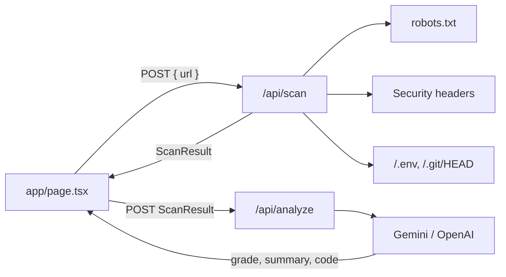

# DevSec Guard

**See what crawlers and attackers see first.**

DevSec Guard is a Next.js web app that runs a quick, non-intrusive security check on a public website. You paste a URL. It checks whether AI scrapers are blocked, which security headers are missing, and whether development files are exposed. Then an AI auditor (Gemini or OpenAI) gives the site a grade and writes a configuration snippet you can paste in to fix the problems.

> [!IMPORTANT]
> Only scan sites you own or have permission to test.

---

## Features

| Check | What it does |
|---|---|
| **AI Scraper Defense** | Fetches `/robots.txt` and evaluates whether `GPTBot`, `ClaudeBot` and `CCBot` are disallowed from the site root. Follows RFC 9309: bot-specific groups override `User-agent: *`, the longest matching rule wins, `Allow` wins ties, and `*` / `$` wildcards are supported. |
| **Security Headers** | Inspects the final response (after redirects) for `Content-Security-Policy`, `X-Frame-Options` (or CSP `frame-ancestors`) and `Strict-Transport-Security`. HSTS only counts when the final URL is served over HTTPS. |
| **Dev Leaks** | Requests `/.env` and `/.git/HEAD` without following redirects. It compares the body against a signature, so a real exposed file is reported separately from a catch-all page that just returns `200` ("soft-200"). |
| **AI Remediation** | Sends the findings to an LLM, which returns a grade from A+ to F, a short summary and a remediation snippet (nginx, `.htaccess`, `next.config.js`, `vercel.json`, `robots.txt`, …) with syntax highlighting and a copy button. |

### Built-in protections

- **SSRF guard:** only `http`/`https` URLs are accepted. Hostnames are resolved, and loopback, private, link-local (cloud metadata), CGNAT, benchmarking, documentation, multicast and reserved ranges are rejected. IPv6 transition forms that embed a private IPv4 address are rejected too (`::ffff:7f00:1`, `64:ff9b::/96`, `2002::/16`, …). Every redirect hop is validated again.
- **Bounded I/O:** every outbound request has a timeout, uses `cache: no-store`, and reads only a limited number of bytes from the response.
- **Rate limiting:** an Upstash Redis atomic sliding-window limiter (`UPSTASH_REDIS_REST_URL` + `UPSTASH_REDIS_REST_TOKEN`) applies per client IP across all instances, with an automatic in-memory fallback for local development. `/api/analyze` also has a global cap, so the AI key is protected even if an attacker rotates IPs.
- **Secret-free audit logging:** `lib/audit.ts` emits structured JSON events (`scan.completed`, `scan.blocked`, `analyze.completed`, `rate_limit.exceeded`, `policy.denied`) with hashed client identifiers (`RATE_LIMIT_KEY_SALT`) and automatic redaction of API keys, tokens, credentials, and sensitive query parameters.
- **Authorization & usage policy:** `lib/policy.ts` enforces explicit user permission attestation (`authorized: true`), blocks restricted domains (`.gov`, `.mil`, plus `SCAN_BLOCKED_HOSTS`), supports enterprise domain scoping (`SCAN_ALLOWED_HOSTS`), and supports optional constant-time API token authentication (`SCANNER_ACCESS_TOKEN`).
- **Prompt-injection hardening:** the scan payload is rebuilt field by field. Strings are flattened, control characters and backticks/angle brackets are stripped, and lengths are capped. The data goes inside a `<scan_data>` block that the system prompt marks as untrusted.
- **Secret hygiene:** the Gemini key is sent in the `x-goog-api-key` header (never in the URL). Errors from the AI provider are logged on the server, and the client only sees a generic message.
- **The app's own headers:** CSP, `X-Frame-Options: DENY`, HSTS, `nosniff`, `Referrer-Policy` and `Permissions-Policy` are set in `next.config.mjs`.

---

## How it works



1. The user submits a URL. `/api/scan` normalizes and validates it, then runs the three checks in parallel.
2. The UI renders the three result cards and immediately posts the findings to `/api/analyze`.
3. `/api/analyze` sanitizes the findings, builds the prompt, calls the configured provider in JSON mode, and validates the response.

---

## Project structure

```
devsec-guard/
├── app/
│   ├── api/
│   │   ├── scan/route.ts        # Runs robots.txt, header and leak checks
│   │   └── analyze/route.ts     # Sanitizes findings, calls the LLM, validates JSON
│   ├── layout.tsx               # Root layout + Geist fonts
│   ├── page.tsx                 # Client UI and scan → analyze flow
│   └── globals.css
├── components/
│   ├── ScanForm.tsx             # URL input + submit button
│   ├── ResultCards.tsx          # Scraper defense / headers / leaks cards
│   ├── RemediationCard.tsx      # Grade, summary, highlighted code block
│   └── ui.tsx                   # Card / Pill primitives
├── lib/
│   ├── validate.ts              # URL normalization, SSRF guard, safeFetch, readText
│   ├── rateLimit.ts             # Upstash Redis + in-memory fallback sliding-window limiter
│   ├── audit.ts                 # Structured JSON audit logger with secret redaction
│   ├── policy.ts                # Authorization token check, attestation & host policy
│   └── types.ts                 # ScanResult / AnalysisResult types
├── next.config.mjs              # Security headers for the app itself
└── tailwind.config.ts
```

---

## Getting started

### Prerequisites

- Node.js 18.18+ (Node 20+ recommended)
- An API key for **Google Gemini** (https://aistudio.google.com/apikey) or **OpenAI** (https://platform.openai.com/api-keys)

### Install and run

```bash
npm install
cp .env.example .env.local   # or create .env.local manually (see below)
npm run dev
```

Open http://localhost:3000.

### Environment variables (`.env.local`)

```dotenv
# --- AI provider (required for the AI Remediation card) ---
AI_PROVIDER=gemini            # "gemini" (default) or "openai"
AI_API_KEY=your-key-here      # Gemini or OpenAI API key
AI_MODEL=                     # Optional. Defaults: gemini-flash-lite-latest / gpt-4o-mini

# --- Rate limits (optional, requests per minute) ---
RATE_LIMIT_SCAN_PER_MIN=10            # per IP, /api/scan
RATE_LIMIT_ANALYZE_PER_MIN=5          # per IP, /api/analyze
RATE_LIMIT_ANALYZE_GLOBAL_PER_MIN=30  # all clients combined, /api/analyze
```

| Variable | Required | Default | Notes |
|---|---|---|---|
| `AI_PROVIDER` | No | `gemini` | `gemini` or `openai`. |
| `AI_API_KEY` | Yes* | none | *Scanning still works without it. Only the AI Remediation card returns a "not configured" message (HTTP 503). |
| `AI_MODEL` | No | `gemini-flash-lite-latest` / `gpt-4o-mini` | Any model that supports JSON output. For `gemini-2.5*` and `gemini-3*` models the thinking budget is capped at 512 tokens. |
| `RATE_LIMIT_SCAN_PER_MIN` | No | `10` | Per client IP. |
| `RATE_LIMIT_ANALYZE_PER_MIN` | No | `5` | Per client IP. |
| `RATE_LIMIT_ANALYZE_GLOBAL_PER_MIN` | No | `30` | Shared across all clients. This is the hard ceiling on AI spend. |
| `UPSTASH_REDIS_REST_URL` | Production | none | Upstash Redis REST endpoint for a cross-instance sliding window. |
| `UPSTASH_REDIS_REST_TOKEN` | Production | none | Server-side Upstash token; never expose it to the browser. |
| `RATE_LIMIT_KEY_SALT` | Production | none | Random secret used to hash client identities before writing Redis keys and audit logs. |
| `RATE_LIMIT_NAMESPACE` | No | `devsec-guard` | Prefix for the app's Redis keys. |
| `AUDIT_LOG_ENABLED` | No | `true` | Set to `false` to disable structured JSON audit logging. |
| `REQUIRE_SCAN_ATTESTATION` | No | `true` | Requires `"authorized": true` in `/api/scan` requests confirming domain ownership/permission. |
| `SCANNER_ACCESS_TOKEN` | No | none | Optional shared secret required via `x-scanner-token` or `Authorization: Bearer <token>`. |
| `SCAN_ALLOWED_HOSTS` | No | none | Optional comma-separated allowlist (e.g. `example.com,*.mycompany.com`). When set, all other hosts are rejected. |
| `SCAN_BLOCKED_HOSTS` | No | `.gov,.mil` | Additional comma-separated hostnames or suffixes to block. |

> [!CAUTION]
> `.env*.local` is git-ignored. Never commit real API keys. If a key has been committed or shared, rotate it.

### Scripts

| Command | Description |
|---|---|
| `npm run dev` | Start the dev server |
| `npm run build` | Production build (includes type checking) |
| `npm run start` | Serve the production build |
| `npm run lint` | ESLint (`next lint`) |
| `npx tsc --noEmit` | Type-check only |

---

## API

### `POST /api/scan`

Request: `{ "url": "example.com" }` (`https://` is added if no scheme is given)

Response (`ScanResult`):

```json
{
  "url": "https://example.com/",
  "scannedAt": "2026-10-28T09:00:00.000Z",
  "robots": { "found": true, "status": 200, "bots": [{ "name": "GPTBot", "blocked": true }] },
  "headers": { "status": 200, "items": [{ "key": "csp", "label": "Content-Security-Policy", "present": false, "value": null }] },
  "leaks": [{ "path": "/.env", "status": 404, "state": "safe", "note": "Not publicly served." }]
}
```

`leaks[].state` is one of `exposed`, `soft-200`, `safe` or `unreachable`.

### `POST /api/analyze`

Request: a `ScanResult`. Response (`AnalysisResult`):

```json
{ "grade": "C", "summary": "…", "language": "nginx", "code": "add_header …" }
```

### Error responses

All errors are returned as `{ "error": "<message>" }`:

| Status | Meaning |
|---|---|
| `400` | Invalid URL, private/local address, or malformed payload |
| `429` | Rate limit hit (the `Retry-After` header gives the wait in seconds) |
| `502` | Target unreachable, too many redirects, or the AI provider failed |
| `503` | AI not configured (`AI_API_KEY` missing) |
| `504` | AI provider timed out |

---

## Deployment notes and limitations

- **Rate limiting:** with `UPSTASH_REDIS_REST_URL` and `UPSTASH_REDIS_REST_TOKEN`, the app uses an atomic Redis sliding window shared by every instance. Without both values (intended for local development), it falls back to in-memory limits per instance.
- **Client IP trust.** The limiter reads `x-real-ip` / `x-forwarded-for`. These headers are only reliable behind a proxy that overwrites them (Vercel, or nginx with `proxy_set_header`). The global analyze cap is the backstop against spoofed IPs.
- **DNS rebinding.** Hostnames are resolved and checked before each request, but `fetch` resolves them again on its own. Fully closing this gap requires pinning the resolved IP in a custom HTTP agent.
- **CSP.** The app's CSP allows `'unsafe-inline'` scripts because Next.js injects inline bootstrap scripts. Switch to a nonce-based CSP via middleware for stricter protection.
- **Scope.** The scanner checks a small set of high-signal items. It is not a replacement for a full penetration test.

---

## Tech stack

Next.js 14 (App Router) · React 18 · TypeScript · Tailwind CSS · lucide-react
